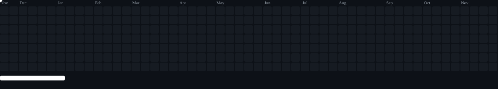

<!-- ================= TERMINAL INTRO ================= -->
<h1 align="center">JOSHNA JOJO</h1>

  <strong>FULL STACK DEVELOPER</strong>
  &nbsp;·&nbsp;
  B.TECH COMPUTER SCIENCE STUDENT

  

<!-- ================= SOCIAL LINKS ================= -->

  
  
  

---

## ABOUT

I'm a Computer Science student focused on full-stack development and building practical software applications.

- Interested in frontend and backend development.
- Exploring AI-powered applications and workflows.
- Enjoy solving programming problems.
- Learning through projects and open-source contributions.

---

## TECHNOLOGIES

  
  
  
  
  
  
  

  
  
  
  
  

  
  
  
  
  
  
  

---

## SELECTED PROJECTS

  
  

---

## GITHUB / ACTIVITY

  
  

---

## CONTRIBUTION ARCADE

  

  BUILD. CONTRIBUTE. REPEAT.

---

  <samp>
    joshna@github:~$ echo "Thanks for visiting!" 
    <b>PROCESS EXITED WITH CODE 0</b>
  </samp>

